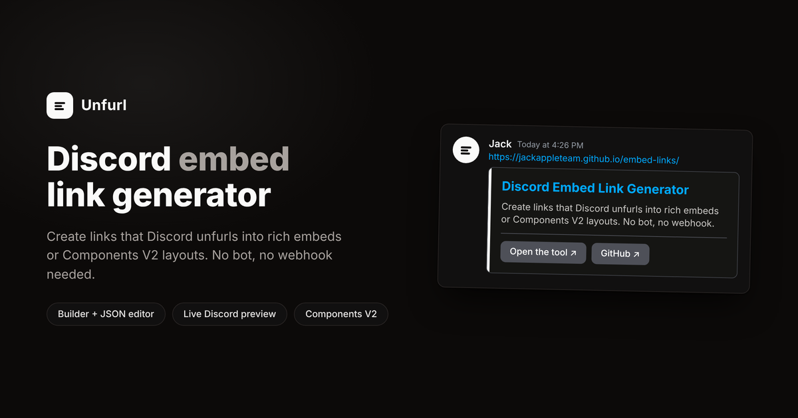

<div align="center">



# Unfurl

**Discord embed link generator** — build rich embeds and Components V2 layouts, then share one link. No bot, no webhook, no token.

[](https://jackappleteam.github.io/embed-links/)
[](https://github.com/Jackappleteam/embed-links/releases)
[](https://github.com/Jackappleteam/embed-links)

[**Open the tool**](https://jackappleteam.github.io/embed-links/) · [Live demo link format](#how-it-works)

</div>

## Features

- 🛠️ **Visual builder + raw JSON editor** — switch between a no-code builder and hand-written Components V2 JSON at any time, both stay in sync
- 👀 **Live, Discord-accurate preview** — see exactly how the embed renders before you share the link
- 🧩 **Full Components V2 support** — Text Display, Section (with thumbnail or link accessory), Media Gallery, Separator, Action Row, all validated against Discord's real limits as you build
- 🔗 **No bot, no webhook, no token** — links are created straight from the browser, nothing to install on your server
- 👻 **Invisible link mode** — copy a link wrapped so Discord shows only the embed, with no visible URL text in the message
- 👤 **Optional Discord login** — log in to save the links you create to "My links" and see them again on any device; link creation itself never requires an account
- ⚡ **Free Cloudflare Worker backend** — short links (`/e/<id>`) backed by KV storage, with a self-contained fallback link if the Worker or storage is ever unreachable
- 🔍 **SEO-ready out of the box** — meta tags, sitemap, robots.txt, and structured data already wired up

## How it works

Discord only reads server-rendered HTML, so each link points at a small Cloudflare Worker (`worker/`) that stores the embed in KV and serves the page Discord reads:

- **Create Link** sends the embed to `POST <worker>/api/create` and gets back a short link like `<worker>/e/ab12cd3`.
- If the Worker or its KV storage is unreachable, the site falls back to a self-contained link (`<worker>/?d=…`) that works without storage as long as it stays under ~2,000 characters.

The Worker URL lives in `js/config.js` (`WORKER_URL`). Change it there if you redeploy under another name.

### Discord login

Logging in is optional — anyone can create a link without it. Logging in with Discord lets a link get saved to that account's "My links" list (stored server-side in KV, not just the browser), and lets the hardcoded admin account manage every link on `/admin.html`.

Sessions are a bearer token in `localStorage`, not a cookie, since the site and the Worker live on different domains.

## Deploying the Worker

```powershell
cd worker
npx wrangler login
npx wrangler kv namespace create EMBEDS   # paste the printed id into wrangler.toml
npx wrangler secret put DISCORD_CLIENT_SECRET   # paste the client secret when prompted
npx wrangler deploy
```

`wrangler.toml` also needs `DISCORD_CLIENT_ID` filled in (not secret, fine to commit) and the Discord app's OAuth2 redirect URI set to `<worker-url>/auth/callback`.

## Components V2 limits (enforced by the builder)

Single top-level Container, up to 40 components, 3,000-byte payload, 10 gallery images, link buttons only. Supported: Text Display, Separator, Section (thumbnail or link button), Media Gallery, Action Row. Open Graph tags are always emitted as a fallback. Test links with Discord's Embed Debugger (https://discord.com/developers/embeds). Discord caches previews about 30 minutes; add `?v=2` to refresh.

## Files

- `index.html`, `css/styles.css` — UI
- `js/app.js` — builder, JSON/HTML tabs, preview, link creation
- `js/render.js` — payload cleaning and page generation (shared with the Worker)
- `js/markdown.js` — Discord-style markdown for the preview
- `js/auth.js` — shared Discord-login helpers (used by `app.js` and `admin.js`)
- `js/config.js` — Worker URL
- `admin.html`, `js/admin.js` — link management for the hardcoded admin Discord account
- `worker/` — Cloudflare Worker (KV short links, Discord OAuth, stats badge)
